# MetaMinds — Top 10 Features to Build Next

*CTO outline, Oct 2026 (v3). Author: Metaminds-CTO. For: Jose. Status: proposal only — comment freely.*

# Context

* Goal: 100 students / 20 tutors by Dec 31, 2026 (today: 11 paying students).
* What gets us there: proof that tutoring works, trust in how hours are tracked, easy buying and booking, and a booking flow that only offers what each tutor can deliver.
* Stack: Next.js app + Supabase Postgres with RLS (repo: metaminds_website).
* Gap: hours live in one mutable balance per student (user_packages). No record of who added hours, when, or why.
* Gap: the referral free hour is homepage copy only. Nothing tracks it.
* Gap: homepage results/stats (500+, +200pts, 98%) are hardcoded and not backed by data.
* Gap: In-Person is offered to families whether or not the assigned tutor does in-person.
* Gap: no place to record school grades or SAT scores, so there is no way to show results.
* Gap: purchase_requests exist but families can't pay online; consultations live only in Calendly.

# Mockups

* Every feature has at least one mockup, built on the current portal design (slate sidebar, white cards, blue-600 accents, Inter) and the live website. Names are fake placeholders; numbers are sample data. Dashed orange boxes = new.
* Images are embedded under each feature. The files are in docs/roadmap/mockups/.

# The 10 Features

## 1. Per-Tutor Delivery Mode Toggle

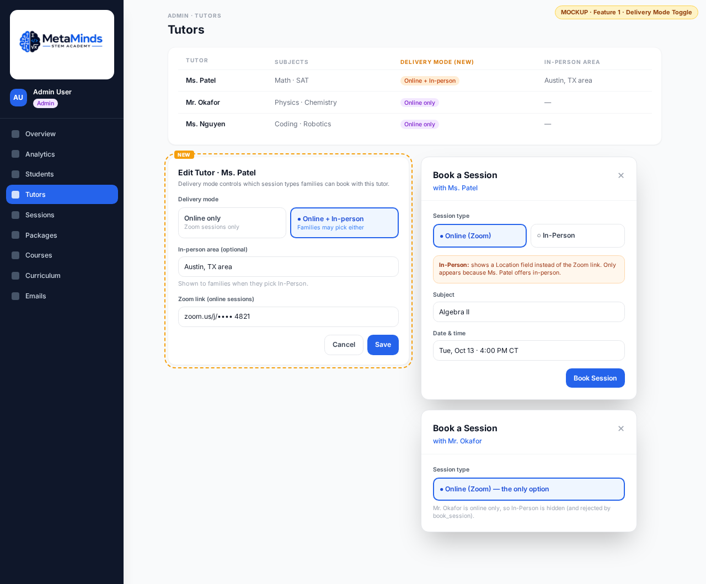

### What it looks like

* Admin: each tutor is set to Online only, or Online + In-person (with an optional in-person area). Tutor can set the same toggle in Settings.
* Booking UI in student, parent, and admin portals, and WeeklyCalendar: the In-Person session type shows only when the assigned tutor offers it.
* Online sessions use the tutor's Zoom link. In-person sessions show a location field instead of Zoom.
* Session emails: Zoom link for online, location for in-person.
* Existing sessions are untouched.
* Website: MetaMinds leads with online tutoring, and in-person is a secondary option depending on tutor availability (Jose, Oct 12). Draft PR #22 copy needs to match.

### Why it matters

* Jose keeps in-person as an option without misleading families.
* Stops families booking a tutor who can't do in-person.
* Small and quick, so it goes first.

### Rough scope

* Data model (new migration, 063+): tutors.offers_in_person boolean default false; optional tutors.in_person_area text.
* Enforce in book_session: reject in_person if the tutor doesn't offer it. Plus UI filtering.
* Code note: students already have allow_in_person. In-Person should show only when the tutor offers it AND the student is allowed.
* UI: admin tutor form + tutor Settings toggle, booking forms, WeeklyCalendar, email templates (session confirmation + reminder cron).
* Effort: ~5–7h (backend 2–3h, UI 3–4h) + QA.

### Dependencies / risks

* Default false means every existing tutor starts as Online only until set. Jose to confirm.
* Tutors without a Zoom link on file: check before booking, with a fallback message.
* If a tutor turns in-person off, future in-person bookings need review (existing sessions stay as they are).
* Draft PR #22 copy must be updated to match.

## 2. School Grades Tracker

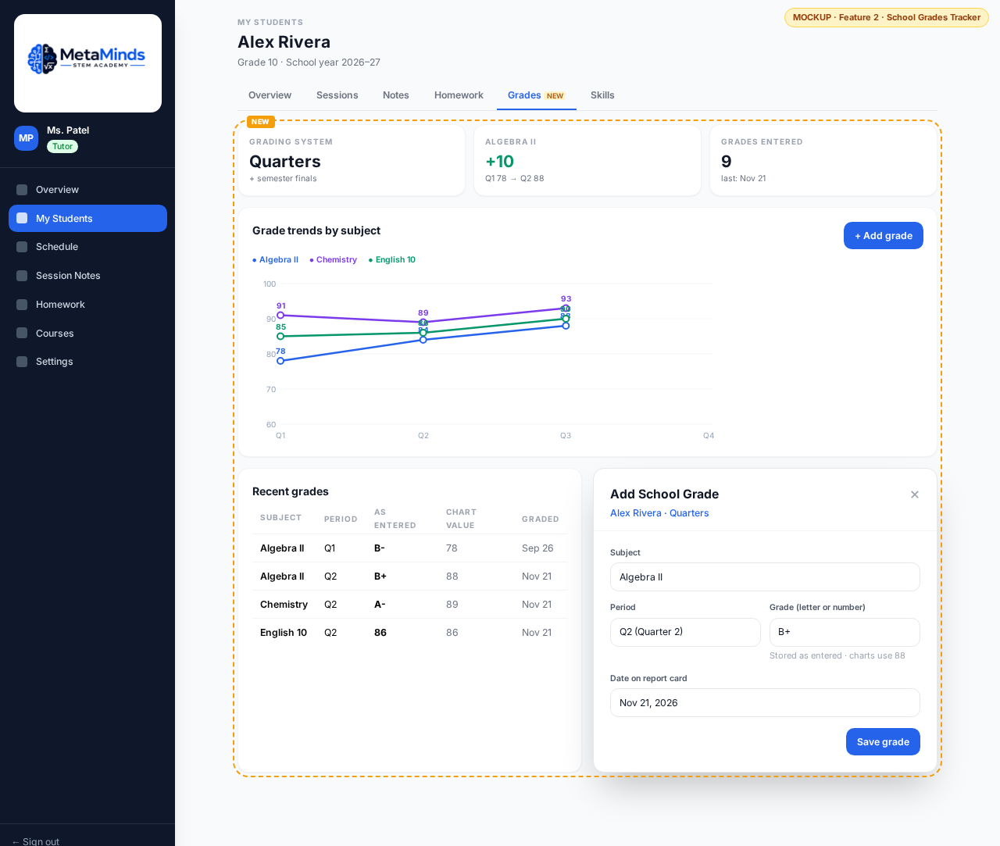

### What it looks like

* Website: nothing at first. Later it feeds real results into #5.
* Admin: set each student's grading system; see and edit all grades.
* Tutor: Grades tab on each assigned student. Add grade: subject, period (Q1, Six Weeks 3, Final...), grade as written on the report card, date, note.
* Parent / Student: read-only per-subject trend (e.g., Algebra Q1 78 → Q2 88). Parent entry comes later.
* Parent Updates: option to include the latest grade change for subjects covered.

### Why it matters

* Proves results: grades going up is the clearest proof parents care about.
* Retention: families who see progress stay and buy more hours.
* Growth: real before/after numbers feed testimonials and the website (#5).
* Every week we don't collect this is lost proof.

### Rough scope

* Data model (063+): student_grading_systems (student_id, system enum: quarters / six_weeks / nine_weeks / trimesters / semesters, includes_finals, school_year).
* school_grades (id, student_id, subject, period_label, period_index, school_year, grade_raw text, grade_numeric numeric null, entered_by, entered_at, graded_on date, note).
* Store the grade as entered (letter or number). Normalize to numeric for charts (letter → number mapping in one place).
* RLS: admin all; assigned tutor read/write their students; parent/student read own.
* UI: grading-system picker, grade entry form, per-subject grade table, trend chart.
* Effort: ~12–16h backend + UI, +3–4h trend chart.

### Dependencies / risks

* Schools use different scales (letter, 100-point, 4.0, +/-). The mapping must be clear and editable.
* Depends on tutors (later parents) actually entering grades. Needs a reminder at the end of each grading period.
* Siblings can be on different school systems, so the system is set per student.

## 3. SAT Program Flag + Score Tracking

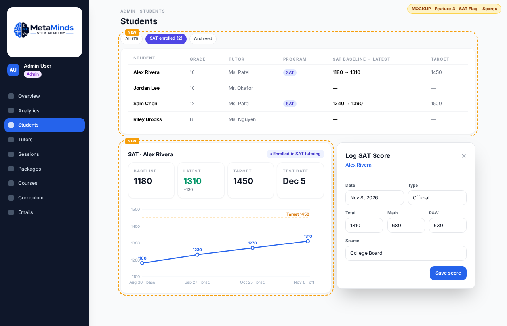

### What it looks like

* Website: the SAT prep section can later show real aggregate improvement once data exists (via #5).
* Admin / Tutor: per-student toggle "Enrolled in SAT tutoring," with target score and test date. Student lists filterable by SAT.
* Tutor: log scores (baseline, practice, official) with date, total, Math, R&W.
* Parent / Student: mini chart of score history vs. target.

### Why it matters

* SAT is a clear, high-value program with numbers families understand.
* Proves results: baseline → official score is strong marketing proof.
* Ops: shows who is in the SAT program so we can staff it.

### Rough scope

* Data model (063+): sat_enrolled bool, sat_target_score, sat_test_date on the student.
* sat_scores (id, student_id, taken_on date, type baseline / practice / official, total, math, reading_writing, source, entered_by).
* Code note: students.programs already can hold "SAT Prep", and there is a SAT roadmap graph and practice-test score report. Reuse them where it fits.
* RLS: same pattern as grades.
* UI: toggle + filter (~3h), score entry + history + mini chart (~4–5h).
* Effort: ~6–8h total.

### Dependencies / risks

* Low risk. Reuse the chart from #2.
* Practice scores from different sources aren't equally reliable. Tag the source.

## 4. Hours Ledger + Referral Credits

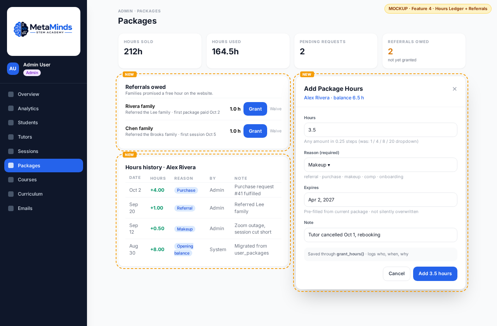

### What it looks like

* Website: the referral free-hour promise becomes real (tracked and honored).
* Admin: Add Hours modal gets a required reason and a free number input (step 0.25, so 3.5 works) instead of the 1/4/8/20 dropdown. Expiry is pre-filled, not silently overwritten.
* Admin: Packages tab gets a "Referrals owed" block listing credits not yet granted.
* Admin: student profile shows grant history (who, when, why, how many).
* Parent (optional): hours history — purchased, used, credited.

### Why it matters

* Ops: today nobody can answer "why does this student have these hours?"
* Trust: families can see exactly where their hours came from.
* Growth: referrals are a cheap growth channel only if we honor them reliably.

### Rough scope

* Data model (063+): hour_grants (id, student_id or package_id, hours numeric(6,2), reason enum referral / purchase / makeup / comp / onboarding, granted_by, granted_at, note, related purchase_request or referral).
* referrals (id, referring family, referred family, status owed / granted / waived, created_at, grant_id).
* grant_hours() DB function: the only path to add hours. Inserts the grant row and updates user_packages in one transaction.
* Fulfilling a purchase_request creates a "purchase" grant (and later, #6 payments do the same).
* Effort: ~2 days admin-only (backend 6–8h, UI 8–10h), +2–3h family-facing view.

### Dependencies / risks

* Lock down direct writes to user_packages so every change goes through grant_hours().
* Existing balances have no history: add one "opening balance" grant per student.
* Open business rules (see Decisions).

## 5. Results Dashboard + Progress Reports

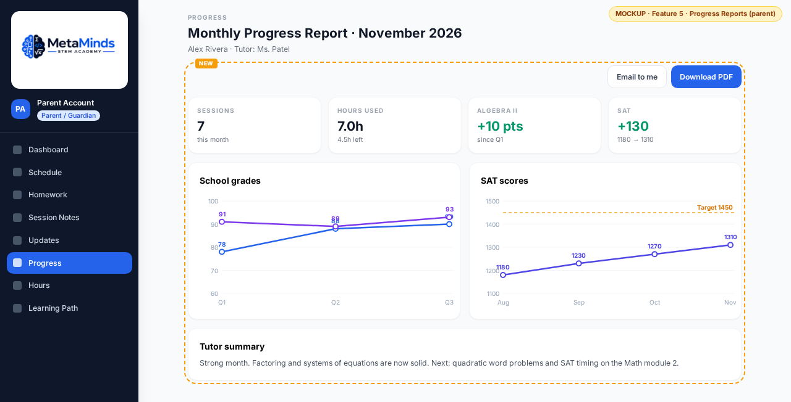

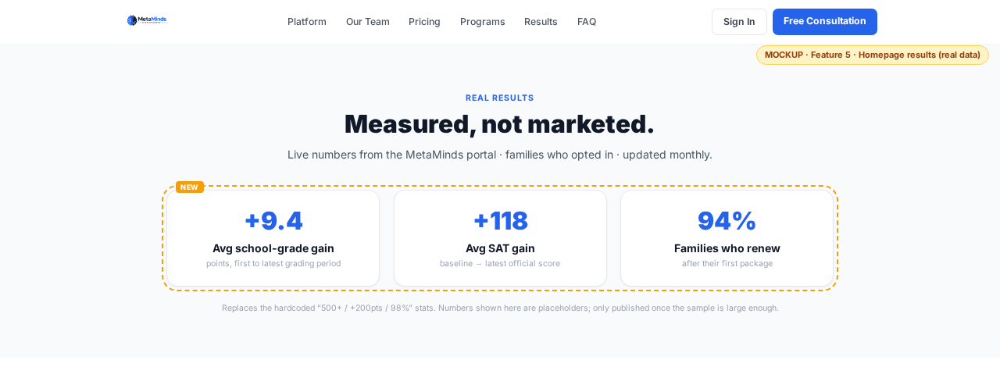

### What it looks like

* Parent portal: the existing Progress tab gains a monthly report with grade trends (#2), SAT scores (#3), sessions and hours used, and tutor notes.
* Monthly / term report per student, auto-built, with PDF and email export.
* Admin: aggregate results view (opt-in, anonymized), e.g., average grade change per subject, average SAT gain.
* Website: replace the hardcoded homepage stats with real numbers once we have enough data.

### Why it matters

* Proves results to families every month, without extra tutor work.
* Retention: a monthly report is a natural renewal moment.
* Growth: honest, data-backed homepage numbers. Removes the risk of claims we can't support.

### Rough scope

* Mostly reads from #2, #3, sessions, hours, and session notes. Maybe a progress_reports table (student_id, period, generated_at, sent_at) for history.
* UI: report in Progress tab, report template, PDF/email export, admin aggregate view, homepage stats component.
* Effort: ~14–20h, after #2 and #3.

### Dependencies / risks

* Depends on #2 and #3 having real data. Too little data → don't publish numbers yet.
* Public stats must be aggregate only, opt-in, and never show anything that could identify a student.

## 6. Online Checkout for Packages

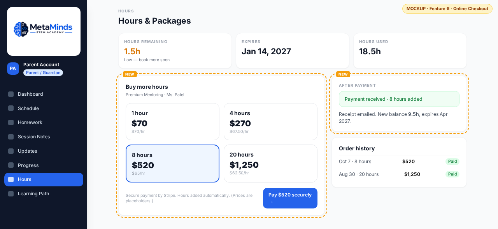

### What it looks like

* Website: pricing section can offer "Buy hours" for existing families (new families still start with a free consultation).
* Parent portal (Hours tab): pick a package, pay with Stripe Checkout, see order history and receipts.
* After payment: hours are added automatically through the hours ledger (#4) with reason "purchase."
* Admin: orders list (paid / refunded / failed); purchase_requests become paid orders instead of manual follow-ups.

### Why it matters

* Growth: removes the "email us to buy more" step. Faster renewals, fewer lost top-ups.
* Ops: no manual invoice chasing or hand-entered hours.
* Data: real revenue numbers for the business dashboard (#10).

### Rough scope

* Data model (063+): orders (id, family/parent_id, student_id, package_key, hours, amount_cents, currency, stripe_checkout_session_id, stripe_payment_intent_id, status pending / paid / refunded / failed, created_at, paid_at, purchase_request_id null).
* Server: create-checkout API route; Stripe webhook route (verify signature) that marks the order paid and calls grant_hours() exactly once (idempotent on the Stripe event id).
* UI: package picker + pay button in Hours tab, success/cancel pages, admin orders list.
* Effort: ~12–16h + Stripe test-mode QA.

### Dependencies / risks

* Depends on #4 (grant_hours) so paid hours are logged correctly.
* Needs a Stripe account, final package/price list, and a refund policy.
* Webhook must be idempotent so a retry never grants hours twice.
* Card data never touches our app (Stripe-hosted checkout).

## 7. Session Recaps for Every Session

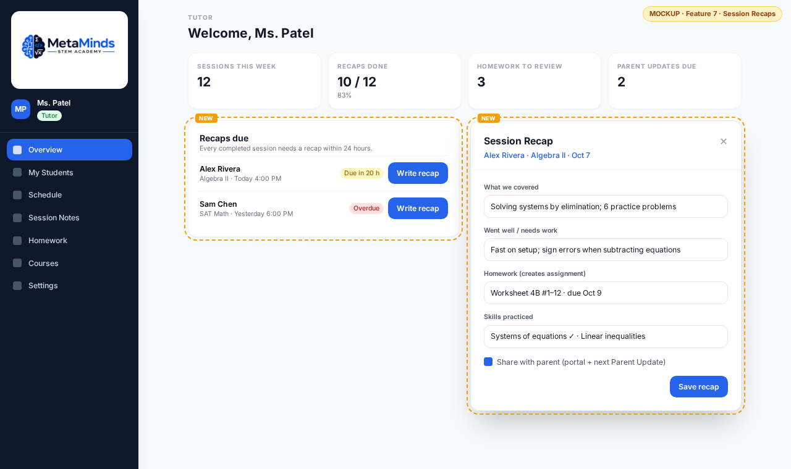

### What it looks like

* Tutor portal: a "Recaps due" list for every completed session without a recap (due within 24h; overdue in red).
* Recap form: what we covered, went well / needs work, homework (creates the homework item), skills practiced, share with parent.
* Parent / Student: recap shows on the session in Session Notes and Schedule.
* Parent Updates: weekly email pulls recaps automatically, so tutors don't retype.
* Admin: recap completion rate per tutor.

### Why it matters

* Backs the website claim "Session Notes, Every Time" / "notes after every session" with a real check.
* Proves value to parents after every session; supports retention.
* Ops: one place to see which tutors are falling behind.

### Rough scope

* Code note: session_notes already exist (topic, notes, note_date, optional session_id, attachments). This feature makes them reliably linked to sessions and tracked.
* Data model (063+): session_notes gets structured fields (covered, went_well, needs_work, shared_with_parent bool) and a unique link to session_id; sessions get recap_due_at.
* View or query: completed sessions with no recap.
* UI: Recaps due list, recap form, parent display, Parent Update auto-fill, admin completion stat.
* Effort: ~8–10h.

### Dependencies / risks

* Tutors may see it as extra work. Keep the form short (2 minutes).
* Older notes not tied to a session need a one-time match (existing code already matches by date).

## 8. Automated Reminders & Low-Hours Alerts

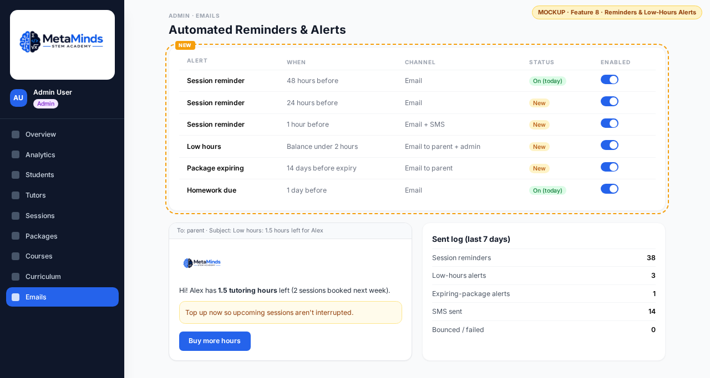

### What it looks like

* Families: session reminders at 48h (exists today), plus 24h and 1h; optional SMS for the 1h reminder.
* Families + admin: low-balance alert (e.g., under 2 hours) and package-expiring alert (e.g., 14 days before), with a "Buy more hours" button (links to #6).
* Admin (Emails tab): turn each alert on/off, see a sent log.
* Parent Settings: email/SMS preferences.

### Why it matters

* Fewer no-shows and late joins.
* Retention and revenue: families top up before they run out instead of quietly stopping.
* Ops: replaces manual checking (admin Overview already flags students under 3 hours).

### Rough scope

* Code note: a daily Vercel cron (send-reminders) already sends 48h session and homework-due emails via Resend, with reminder_sent_at to avoid duplicates.
* Data model (063+): notification_settings (alert_type, enabled, threshold, channel); notification_log (type, target_id, sent_at, channel, status); per-session reminder_24h_sent_at / reminder_1h_sent_at; parent notification preferences.
* Server: more frequent cron (hourly) for 24h/1h; SMS provider (e.g., Twilio) behind a flag.
* Effort: ~8–12h (email only ~6–8h; SMS +2–4h).

### Dependencies / risks

* SMS needs explicit opt-in and has per-message cost.
* Timezones: reminders must use each family's timezone (already stored).
* Avoid spam: one alert per threshold crossing.

## 9. Lead & Trial Pipeline

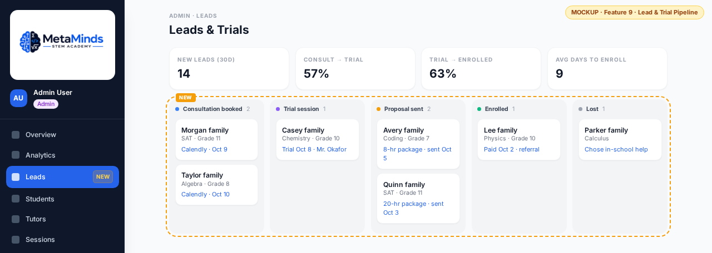

### What it looks like

* Adjusted from the suggested "Tutor Availability + Self-Booking": the code already has tutor_availability, blocked dates, book_session (with lead-time checks), and bulk booking. Delivery-mode filtering is covered by #1.
* Admin: new Leads tab, a board with Consultation booked → Trial session → Proposal sent → Enrolled → Lost.
* Leads come in from Calendly consultation bookings automatically; admin can add one by hand.
* Each lead: subject, grade, source (referral, ad, search), next step, assigned tutor for the trial.
* Enrolled converts the lead into a student (reuses the existing onboarding wizard).

### Why it matters

* Growth: going from 11 to 100 students means many more consultations. Today they live only in Calendly and memory.
* Shows conversion rates (consult → trial → enrolled) so Jose knows where families drop off.
* Feeds the referral flow (#4): a lead marked "referral" creates the owed credit when they enroll.

### Rough scope

* Data model (063+): leads (id, family label, contact fields admin-only, subject, grade_level, source, referrer_family_id null, stage enum, trial_session_id null, tutor_id null, lost_reason, created_at, stage_changed_at); lead_events (lead_id, from_stage, to_stage, by, at, note).
* RLS: admin only (contact data is sensitive).
* Server: Calendly webhook (invitee.created) → create lead; dedupe by email.
* UI: Leads board, lead detail drawer, "Convert to student" action, conversion stats.
* Effort: ~12–16h.

### Dependencies / risks

* Calendly webhooks may need a paid Calendly plan; fallback is manual entry.
* Contact details must stay admin-only and never show in tutor views or public pages.

## 10. Business & Goal Dashboard

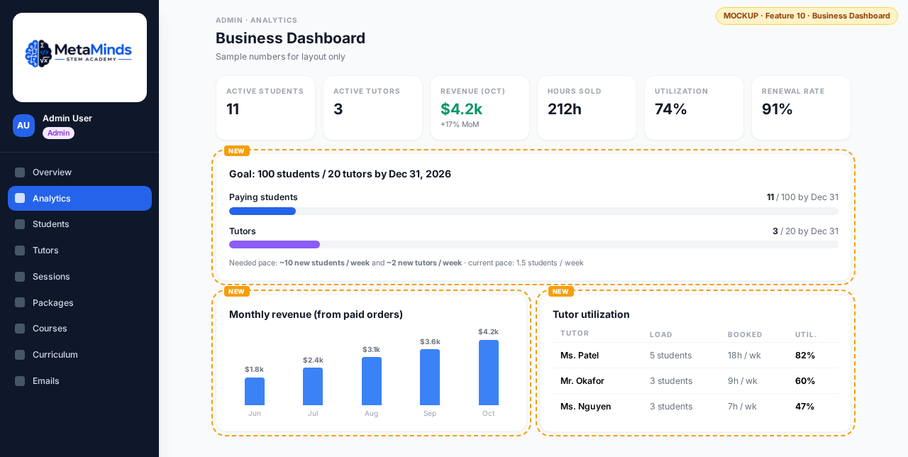

### What it looks like

* Admin Analytics tab (already shows active students, sessions/month, hours sold/used, utilization, online vs in-person) gains:
* Goal tracker: paying students vs 100 and tutors vs 20 by Dec 31, with the weekly pace needed vs current pace.
* Revenue by month (from #6 orders), renewal/retention rate, average hours per family.
* Tutor utilization and capacity: who can take more students.
* Funnel numbers from #9.

### Why it matters

* Jose sees in one place if the Dec 31 goal is on track and what to fix (leads, conversion, renewals, tutor capacity).
* Hiring: shows when we need the next tutor before families wait.

### Rough scope

* Mostly queries on existing tables plus orders (#6) and leads (#9). Optional nightly snapshot table (metrics_daily) for trends.
* UI: goal bars, revenue chart, retention stat, tutor capacity table.
* Effort: ~10–14h (revenue and funnel pieces after #6 and #9).

### Dependencies / risks

* Revenue numbers are only as good as #6 adoption; offline payments need manual entry.
* Define "active" and "retained" once so numbers don't shift.

# Recommended Build Order

1. #1 Per-Tutor Delivery Mode Toggle — quick; families only see in-person where the tutor actually offers it.
2. #2 School Grades Tracker and #3 SAT Flag + Scores — start collecting data now. Every week without it is lost proof.
3. #4 Hours Ledger + Referral Credits — fixes ops and trust; makes the referral promise real; required by #6.
4. #7 Session Recaps — small; backs a claim the website already makes.
5. #6 Online Checkout — after #4, so paid hours go through the ledger.
6. #8 Reminders & Low-Hours Alerts — the low-hours alert links to checkout.
7. #5 Results Dashboard + Progress Reports — once #2 and #3 have data.
8. #9 Lead & Trial Pipeline — scale consultations toward 100 students.
9. #10 Business & Goal Dashboard — last, once orders (#6) and leads (#9) exist.

Rough total: ~105–140h across all 10. Who does what:

* Backend: DB tables, migrations, RLS, DB functions, webhooks, cron.
* Frontend: portal and website UI.
* CTO: reviews every PR (design, RLS, no PII exposure) before it goes to Jose.

# Decisions Jose Needs to Make

* Approve this list and order (or change it).
* Delivery mode (#1): default for existing tutors (Online only, or set each one now)?
* Delivery mode (#1): can tutors change their own toggle, or admin only?
* Delivery mode (#1): does in-person need a service-area limit?
* Grades (#2): tutors only at first, or parents can enter too from day one? Which grading systems at launch? Finals as separate entries?
* SAT (#3): separate paid program or a flag on regular tutoring?
* Referrals (#4): how many hours per referral, and what triggers it (sign-up, first paid package, first session)?
* Referrals (#4): which sibling gets the hour in a multi-student family? Can credits be waived, and by whom?
* Hours (#4): should families see their full hours history?
* Checkout (#6): Stripe account, final package list and prices per tier, refund policy.
* Recaps (#7): required for every session? Deadline (24h?) and should it affect tutor pay?
* Alerts (#8): low-hours threshold, expiry warning window, and whether to add SMS (cost + opt-in).
* Leads (#9): OK to connect Calendly webhooks (may need a paid plan)? Which lead sources to track?
* Results (#5/#10): minimum number of students before publishing public stats? Opt-in wording for families?

# How We Ship

* Nothing is built until Jose approves via the CEO.
* Every change ships on a feature branch + PR, merged only with Jose's okay.
* Migrations are new numbered files. 062 is taken by an undeployed session-scope fix, so these start at 063+.
* No student PII in docs, PRs, mockups, or public pages.
